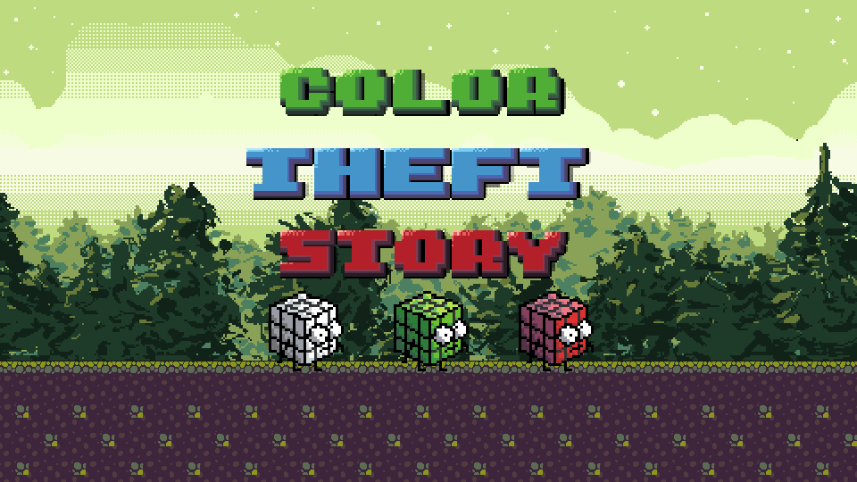
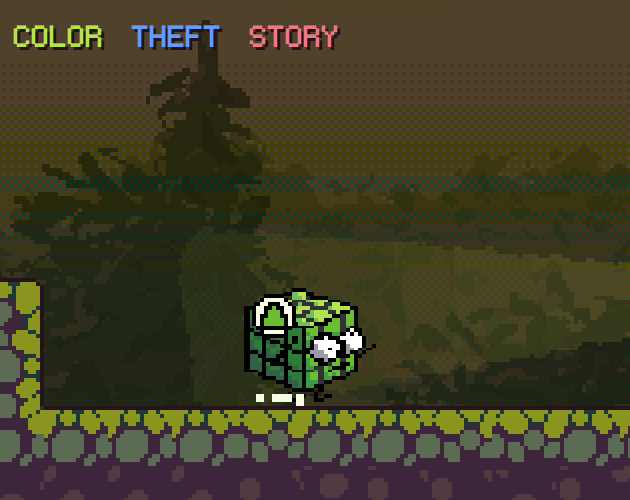
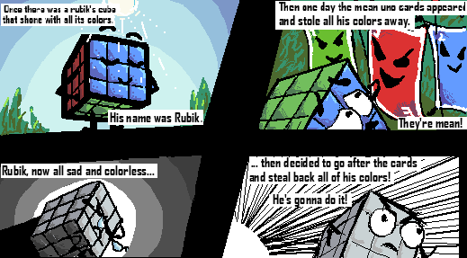
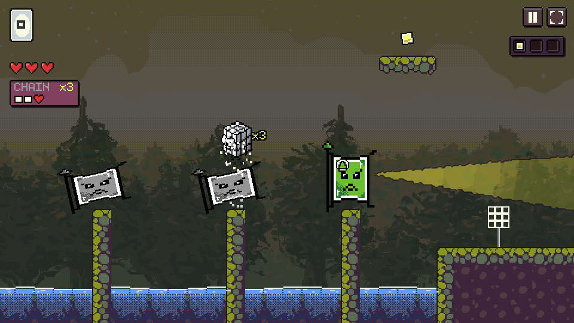
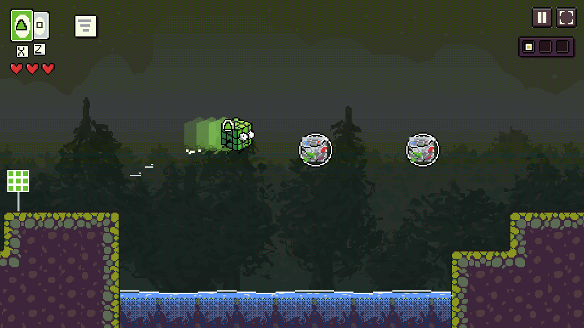
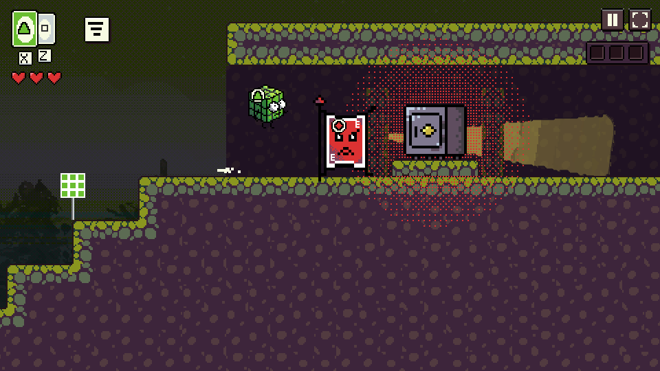
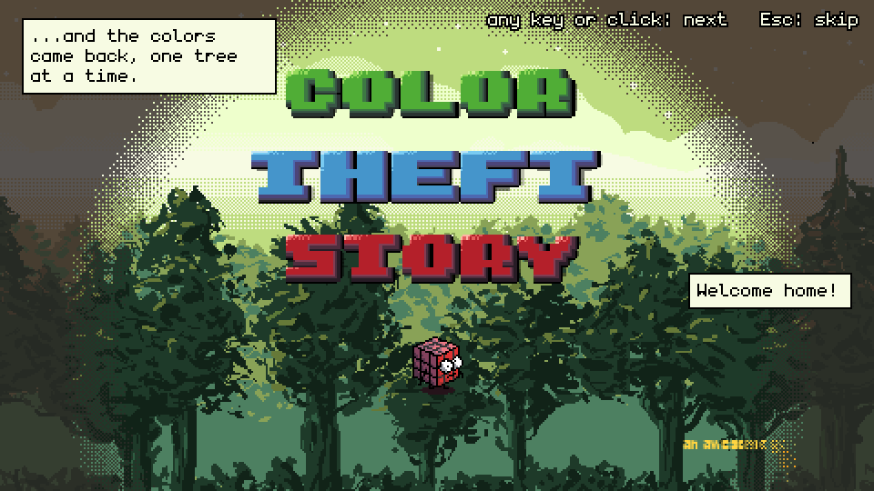

<div align="center">



# Color Theft Story

**You are a rubik's cube fighting against color theft in cubeland.**

Rubik lost his colours to a gang of angry Uno cards.<br>
Sneak past them, stomp them, and take the colours back. This is World 1: Green Forest.

[](https://caucau.itch.io/color-theft-story-2)


</div>

---

Turn the sound on and run. You can play it right now in your browser, no install, at **[caucau.itch.io/color-theft-story-2](https://caucau.itch.io/color-theft-story-2)**. This repository is the source. It is also called *Color Rush Heist* in the code.

<p align="center">
  
</p>

## About

A 2D action-stealth platformer built from the original Color Theft Story's art. Rubik starts colourless on his home cliff. Over six short levels he learns to jump twice, stomp awake Uno cards from behind, steal green from a card that holds it, hide among green cards, catch a storm swirl that lets him dash, and read lookouts. Then he steals his red back from the vault and runs the same forest in reverse, smashing sealed stones on the way home.

Every level teaches one thing and then twists it:

| Level | Name | What it teaches |
| --- | --- | --- |
| 1-1 | Home Cliff | The double jump |
| 1-2 | Stomping Ground | Stomp a card's head. Steal green. |
| 1-3 | Hide in Green | Disguise: green Rubik hides among green cards |
| 1-4 | Storm Dash | The dash, and the orbs that refill it |
| 1-5 | Lookouts | Reading what each card can see, and the spear |
| 1-6 | The Vault | Everything at once, then the run home in reverse |

What makes it different:

- **Every card is awake and has a job.** Some patrol, some hold a post, some turn on a timer, and the red one charges. A card asks "?" before it shouts "!", so you get a moment to change your mind.
- **Disguise or stomp.** The colour you wear decides who can see you. Or jump on a card's head and it goes poof.
- **Three hearts.** A spear, a card's body or a fall into the water costs one. A new checkpoint fills them again, and checkpoints come about every twelve seconds of play.
- **Crisp movement.** Variable jump height, a short grace after leaving a ledge, a jump buffer, and a dash you get back from the storm orbs.
- **Stickers and stamps.** Every level has three stickers. Some have stamps: Ghost for never being spotted, Takedown for putting every card down, Quick for the vault's par time.
- **It reads without colour.** White is a square, green a triangle and red a diamond, on Rubik, on every card and on the red-only stones. *Slow spotting* gives the cards twice as long to notice you, and *Less motion* removes the shake and the flashes. Both are in the pause menu.

## Controls

| Key | Action |
| --- | --- |
| `A` `D` or `←` `→` | Move. Also moves along the world map. |
| `Space`, `W` or `↑` | Jump. Hold for height. White Rubik jumps twice. Also enters a level on the map (`Enter` too). |
| `Shift`, `K` or `J` | Dash, from level 1-4 on. |
| `Z` `X` `C` (or `1` `2` `3`) | Switch to white, green or red, once you own that colour. |
| `R` | Back to the last checkpoint. |
| `P` or `Esc` | Pause in a level, menu on the map. |

Any key starts the title and skips the comic.

## The story, in four panels

The game opens with the original comic.

<p align="center">
  
</p>

## Screenshots

<table>
  <tr>
    <td width="50%"></td>
    <td width="50%"></td>
  </tr>
  <tr>
    <td align="center"><sub>1-2 · Stomping Ground</sub></td>
    <td align="center"><sub>1-4 · Storm Dash</sub></td>
  </tr>
  <tr>
    <td width="50%"></td>
    <td width="50%"></td>
  </tr>
  <tr>
    <td align="center"><sub>1-6 · The Vault</sub></td>
    <td align="center"><sub>The ending</sub></td>
  </tr>
</table>

## Run it locally

You need Node.js 18 or newer. Nothing to install. The game loads ES modules, so it has to be served over HTTP, and `npm run dev` does that.

```sh
git clone https://github.com/cauesmelo/color-rush-heist.git
cd color-rush-heist
npm run dev          # then open http://127.0.0.1:4174
npm test             # model, levels, movement, save, combat, human-like players, credits and the ending
npm run build:itch   # writes dist/color-rush-heist-itch.zip, the file uploaded to itch.io
```

No CDN, account or backend.

## How it is built

Plain JavaScript with ES modules and a Canvas 2D renderer. No framework and no runtime dependencies.

- The simulation (`model.mjs`) is pure and deterministic, and runs on a fixed-step clock (`loop.mjs`), so input is applied on the tick it happened.
- Each level is one frozen data module in `levels/`. The tests replay recorded routes through every level, and include players that react like a person, not a perfect bot.
- All of the interface is pixel art drawn on the original art's own 2x grid, in a palette taken from the art files, with bitmap text.
- The original art is kept untouched. All 103 images from the original Godot project sit in `assets/`, byte for byte (the tests check their hashes). 43 are on screen in this build. The rest, such as World 2's art, stay in the archive, and `gallery.html` is a viewer for the whole collection.

## Documentation

- [DEVELOPMENT.md](DEVELOPMENT.md): the full engineering notes (movement, mechanics, accessibility, save, QA interface, validation)
- [LEVEL_DESIGN.md](LEVEL_DESIGN.md) and [LEVEL_DESIGN_V1.md](LEVEL_DESIGN_V1.md), [MOVEMENT_AUDIT.md](MOVEMENT_AUDIT.md), [UI_STYLE.md](UI_STYLE.md)
- [CHANGELOG.md](CHANGELOG.md) and [ITCH_IO.md](ITCH_IO.md) (the export notes)
- Design briefs: [RESEARCH.md](RESEARCH.md), [RESEARCH_PROGRESSION.md](RESEARCH_PROGRESSION.md), [RESEARCH_COMBAT.md](RESEARCH_COMBAT.md)

## Status

- Only World 1 is built, and the story ends after the vault run. The blue mountains from the original game are in the art archive and have no levels yet.
- Keyboard play, in a desktop browser. Tested in Chrome; Firefox and Safari have not been tried.
- If your browser blocks storage (a private window, for example) the game still plays but forgets your progress when you close the tab.

## Credits

- **Original game:** Color Theft Story, by Vitor Farias and Cauê Melo ([@cauesmelo](https://github.com/cauesmelo)), minigamejam 22, 2023.
- **Pixel art:** Vitor Farias.
- **Sound:** the music is the original game's track. The effects are made in the browser.
- **Font:** monogram by datagoblin (CC0).
- **Web version, 2026:** built with AI assistance (Claude Code).

The art and music come from the original game, and their ownership stays with its authors. The original repository's MIT licence (Copyright 2023 nklbdev) is kept as `assets/SOURCE-LICENSE.txt`. The `assets/player/` folder is a third-party pack from the original project. The game never uses it, the itch.io build leaves it out, and its licence has not been verified. This repository has no licence file yet.
